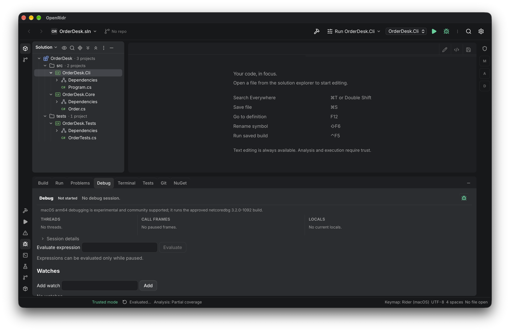

# OpenRidr

[](https://github.com/Heldinhow/openridr/actions/workflows/ci.yml)
[](LICENSE)

An open-source C#/.NET IDE for macOS, built with Tauri 2, Rust and React. OpenRidr is for developers
who want the Rider-style workflow — solution explorer, analysis, build, run, debug, tests and Git —
in a small desktop app, without a JetBrains installation.



[Download](#download) · [Features](#features) · [Build from source](#build-from-source) · [Contributing](CONTRIBUTING.md) · [Community](#community) · [Docs](docs/README.md)

## Status

**Alpha.** Verified only on **macOS 13 or newer, Apple Silicon (arm64)**. Windows and macOS on Intel
are not verified and not supported: a report about them is welcome, but no fix or timeline is
promised. Every release ships its own list of known limitations — read it before relying on a
feature. The app only detects .NET SDKs; it never installs one or edits `global.json`.

## Download

Releases are **prereleases**, so GitHub's "latest release" shortcut does not point at them. Use the
[release list](https://github.com/Heldinhow/openridr/releases) and take the newest alpha.

1. Open the newest release and download `OpenRidr_<version>_aarch64.dmg`.
2. Open the DMG, drag **OpenRidr** into **Applications**, and launch it from there.
3. On first launch macOS asks whether to open an app downloaded from the internet: choose **Open**.
4. Install the .NET SDK your project pins.

Signing, notarization and the DMG's SHA-256 are in the release body; installation details and known
limitations are in [docs/RELEASE-ALPHA.md](docs/RELEASE-ALPHA.md).

## Features

- **Solution explorer** from MSBuild evaluation: projects, references and target frameworks.
- **C# editing** with a bundled csharp-ls: diagnostics, completion, go to definition, find usages,
  rename with preview and code actions. The analyzer and its private .NET runtime ship inside the app.
- **Problems** panel that keeps analyzer and build origins apart.
- **Build** with `dotnet`; **Run** with `Properties/launchSettings.json` profiles, including
  `applicationUrl`, environment variables, arguments and working directory.
- **Debug** through the bundled netcoredbg: breakpoints (conditional ones too), stepping, locals and
  expression evaluation. On Apple Silicon it is community supported; pressing Debug enables the
  experimental flag for the session, and the panel shows a non-blocking experimental note.
- **Tests** through VSTest discovery and runs, with per-test results.
- **Git**: log, diff, commit, branches, pull and push.
- **Terminal**, **NuGet** package listing, **Search Everywhere** and a Rider/IntelliJ keymap.
- **Workspace trust**: analysis and execution stay disabled until you trust a project.

## Build from source

On macOS Apple Silicon you need the Xcode command-line tools, [Rust](https://www.rust-lang.org/tools/install),
[Bun](https://bun.sh/) and the [.NET SDK](https://dotnet.microsoft.com/download) your project pins.

```sh
bun install
bun run tauri dev   # desktop app
bun run check       # TypeScript + cargo check
bun run build       # type check + production UI build
```

A fresh worktree needs its own `bun install`. [AGENTS.md](AGENTS.md) is the authoritative reference
for tools, SDK resolution, tests, E2E and the conventions this repository follows.

## Contributing

Read [CONTRIBUTING.md](CONTRIBUTING.md) for setup, the issue-to-PR flow, conventional commits, CI and
risk tiers. Start from a [good first issue](https://github.com/Heldinhow/openridr/issues?q=is%3Aissue%20is%3Aopen%20label%3A%22good%20first%20issue%22)
or [help wanted](https://github.com/Heldinhow/openridr/issues?q=is%3Aissue%20is%3Aopen%20label%3A%22help%20wanted%22)
issue, and open an issue to agree on the approach before a large change.

## Community

- [Code of Conduct](CODE_OF_CONDUCT.md) — Contributor Covenant 2.1.
- [Security policy](SECURITY.md) — report vulnerabilities through GitHub's private vulnerability
  reporting. The maintainer still has to enable that channel; until then there is no private
  reporting path, so do not open a public issue with exploit details.
- Discussions are not enabled yet. Until the maintainer turns them on, there is no dedicated
  channel for general questions.
- Documentation index: [docs/README.md](docs/README.md).

## License

[MIT](LICENSE) © 2026 Helder Santos. Components in the app bundle are listed in
[THIRD-PARTY-NOTICES.md](THIRD-PARTY-NOTICES.md); Rust and npm dependencies keep their own licenses.
The csharp-ls and netcoredbg components (MIT) are bundled into the
app, not committed here. OpenRidr is not affiliated with JetBrains; "Rider" and "IntelliJ" are
trademarks of JetBrains s.r.o., used only to describe the keymap and the UX inspiration.
