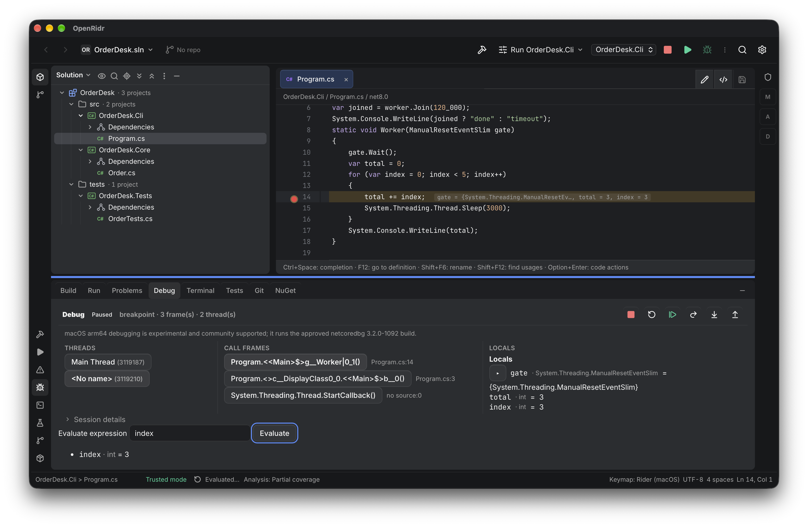
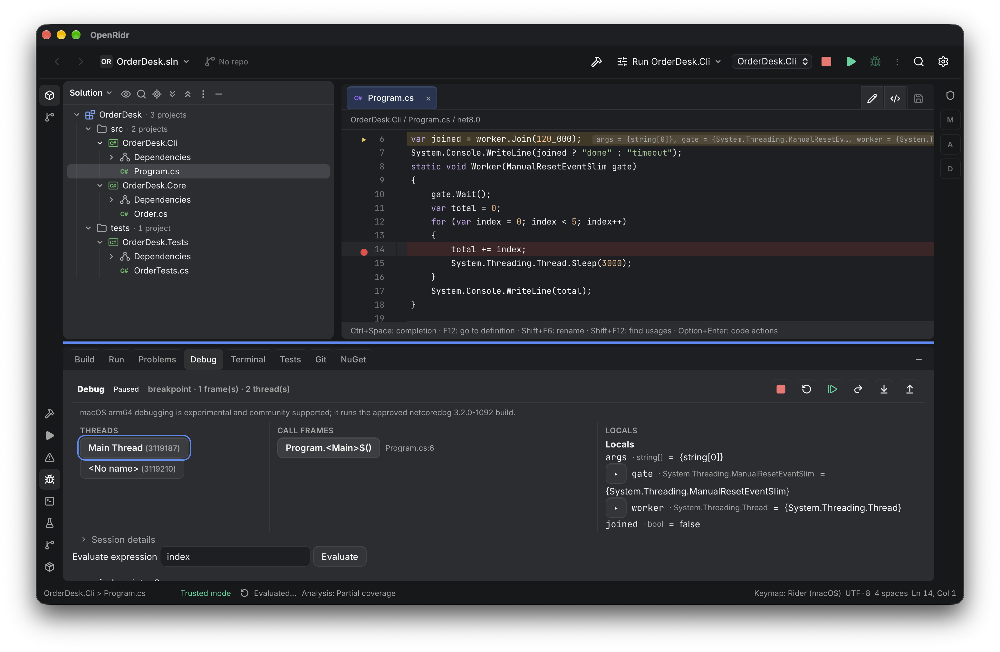
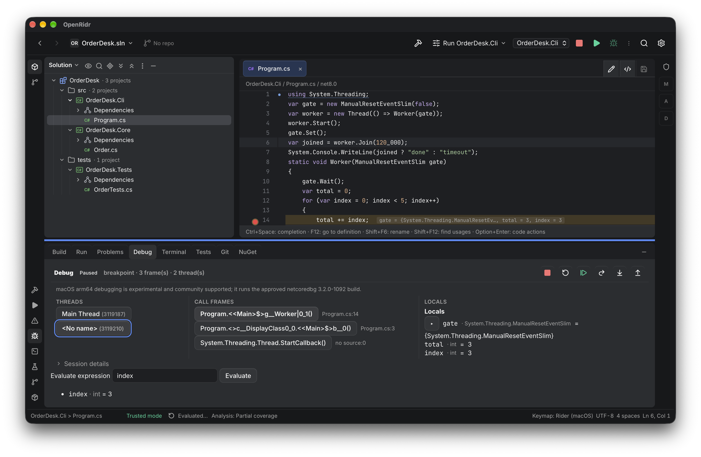
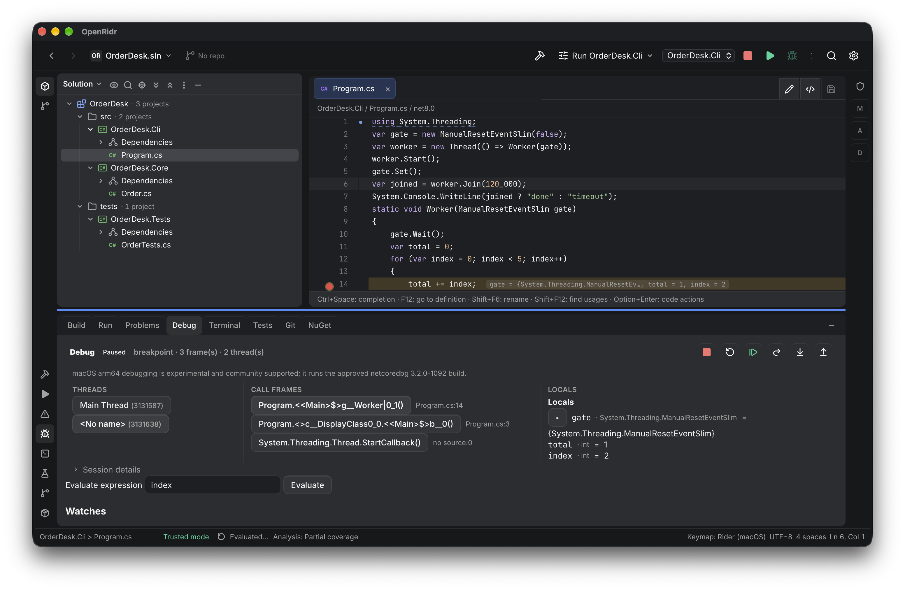
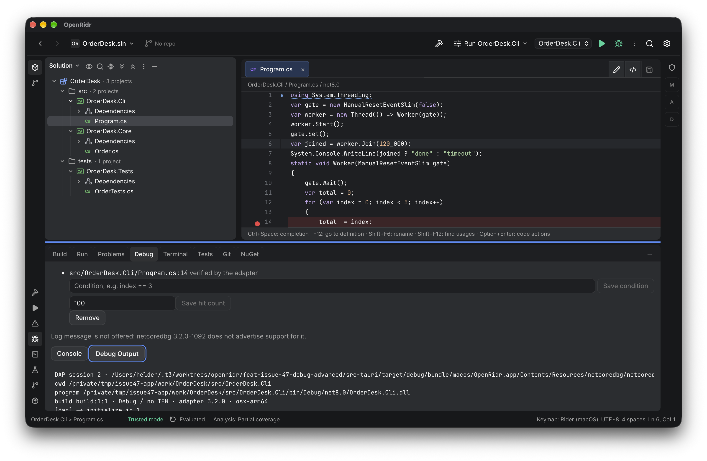

# Evidência — debug avançado no app real (issue #96, 2026-11-06)

Frente: issue [#47](https://github.com/Heldinhow/openridr/issues/47), tickets #94 (hit count),
#95 (watches) e #96 (esta verificação). Spec: [SPEC-DEBUG-ADVANCED](../SPEC-DEBUG-ADVANCED.md).

## Ambiente

- Bundle **0.3.0-alpha.11** construído deste worktree
  (`bun run tauri build --debug --bundles app`), macOS arm64.
- `OPENRIDR_HOME` isolado em `<tmp>/issue47-app/home`; cópia descartável da fixture OrderDesk em
  `<tmp>/issue47-app/work`; `.sln` passado como argv (mesmo caminho do Finder/CLI).
- netcoredbg 3.2.0-1092 **embutido** no bundle (`Contents/Resources/netcoredbg/netcoredbg`);
  nenhum download, nenhuma instalação.
- Uma instância por vez (`pgrep -x openridr` conferido antes/depois); app fechado por
  `verify-openridr/scripts/desktop.sh down` no fim (`stopped`, nenhuma instância restante).
- `agent-desktop` com Acessibilidade e Gravação de Tela concedidas; tela desbloqueada.

A fixture usada tem uma thread trabalhadora e um laço com `Thread.Sleep(3000)` entre as 5
iterações, com breakpoint na linha 14 (`total += index;`), para dar tempo de interagir com o
painel. O código do programa é o da fixture pública, alterado só na cópia descartável.

## Ação → estado observado

| # | Ação | Estado real observado | Captura |
|---|---|---|---|
| 1 | Abrir a solução e clicar **Trust project** | `Trusted mode`, avaliação `Evaluated · Debug · TFM net8.0 · revision 2` | — |
| 2 | Breakpoint na linha 14 (Chrome `Cmd+F8` na linha) e condição `index == 3` salva no painel Debug | breakpoint `src/OrderDesk.Cli/Program.cs:14 · verified by the adapter` | — |
| 3 | **Start debugging** | `Paused · breakpoint · 3 frame(s) · 2 thread(s)`; Evaluate `index` → `index · int = 3`; inline variables `total = 3, index = 3` |  |
| 4 | Adicionar watch `index` com a pausa no frame da worker | watch `index` → `value · int = 3` |  |
| 5 | Selecionar a thread **Main Thread** | watch `index` → `error: The name 'index' does not exist in the current context` (o frame dela é `worker.Join`) |  |
| 6 | Selecionar de volta a thread da worker | watch `index` → `value · int = 3` de novo |  |
| 7 | Limpar a condição, salvar hit count **3** e clicar **Restart** | `Paused` após ~6 s (3ª parada); Evaluate `index` → `index · int = 2`; watch **continuou na lista** e mostra `value · int = 2`; log DAP: `hit count 1/3`, `hit count 2/3`, depois `stopped · reason breakpoint` |  |
| 8 | Hit count **100**, **Resume** e **Pause** logo em seguida | `Paused · pause · 1 frame(s) · 2 thread(s)` — o Pause manual venceu e não foi contado como hit |  |
| 9 | **Resume** até o fim | `Terminated · The debug session terminated.`; log DAP: `hit count 1/100`, `hit count 2/100`, `event exited · exit 0` |  |

A captura 07 mostra também a linha do breakpoint no painel com o hit count `100` salvo e o texto
`Log message is not offered: netcoredbg 3.2.0-1092 does not advertise support for it.`

## O que o log DAP prova

Trecho preservado no painel após o término (sessão 2, `exit 0`):

- `event breakpoint · src/OrderDesk.Cli/Program.cs line 14 · verified true`
- `hit count 1/3 · src/OrderDesk.Cli/Program.cs:14; resuming` e `hit count 2/3 …` antes da pausa
  da 3ª parada — o auto-continue é do host, não do adaptador.
- `event stopped · reason pause` para o Pause manual, com `evaluate` subsequente falhando em
  `index` no frame da main thread.
- `hit count 1/100` e `hit count 2/100` depois do Resume, seguidos de `event exited · exit 0` e
  `session terminated`.

## Efeitos colaterais e limites

- Nenhum processo `openridr` deixado vivo; `desktop.sh down` confirmou `stopped`.
- Nenhum arquivo fora da cópia descartável foi alterado; nenhum download/instalação.
- **Não observado no app real**: o texto do stdout do debuggee no painel. A aba **Debug Output**
  estava selecionada, mas exibiu o log DAP; a aba **Console** é que aponta para o painel de output
  (`data-testid` `dap-output`), ou seja, os rótulos das duas abas estão trocados no código atual.
  O output real (`10` e `done`) é provado no E2E (`dap-output` em
  `tests/e2e/debug-advanced.spec.ts`), não nesta sessão do app. Bug de rótulo registrado como
  observação; fora do escopo desta frente.
- **Falha pré-existente do HEAD**: `tests/e2e/debugger.spec.ts` não passa no HEAD por causa do
  netcoredbg embutido (`debug.install` responde "bundled… nothing to install" e o teste de gates
  espera `experimental_disabled` com bundle presente). Não foi corrigido aqui; o E2E desta frente
  usa host próprio com o adaptador real.
- Windows e macOS Intel não foram executados; não são declarados suportados.
