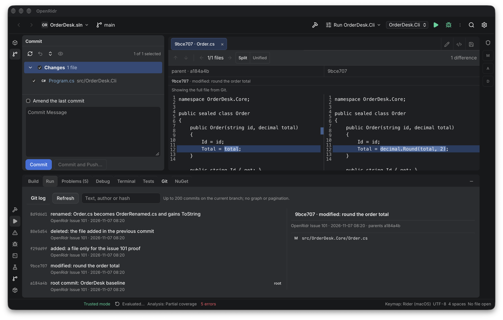
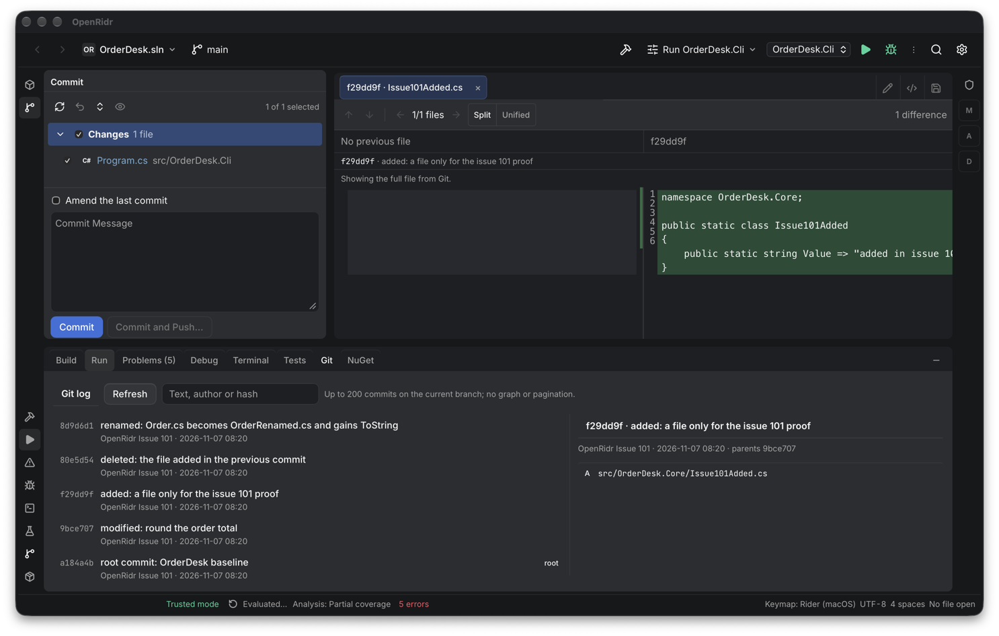
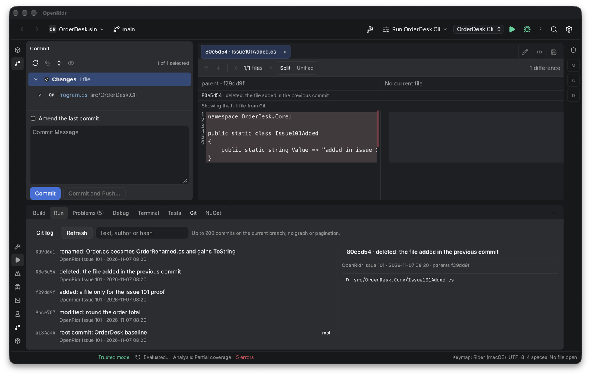
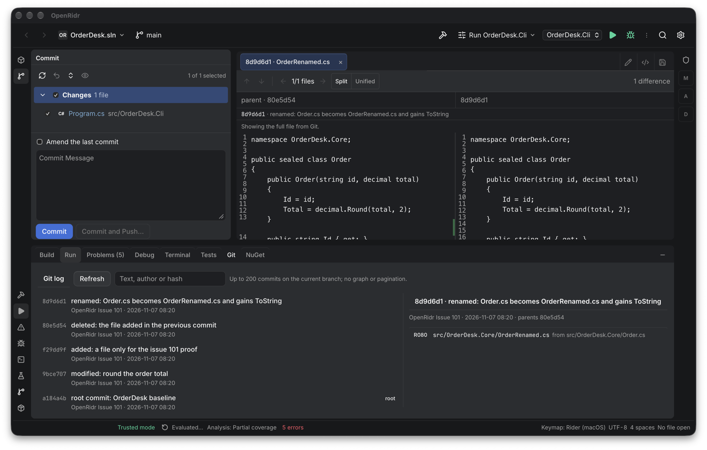
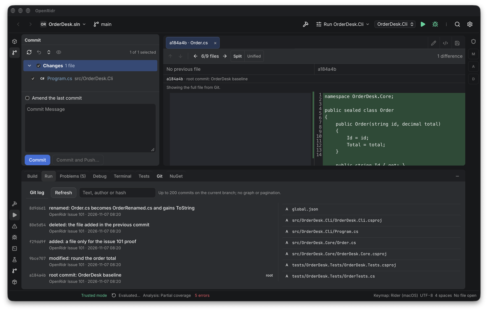
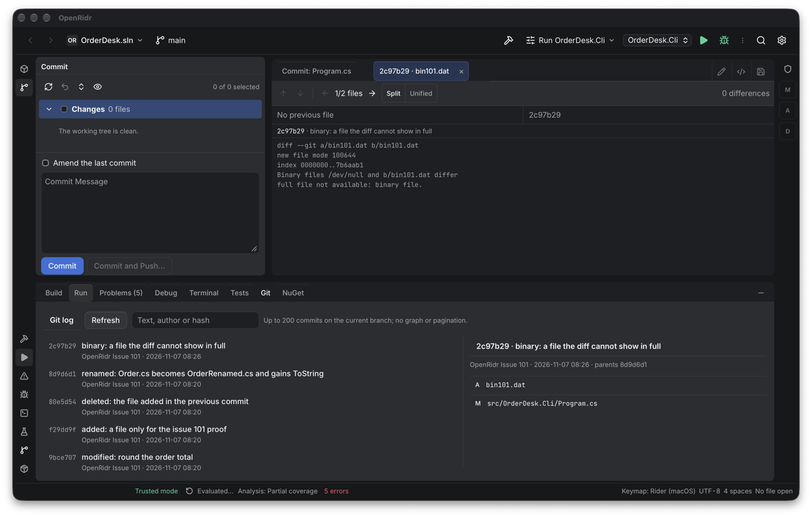
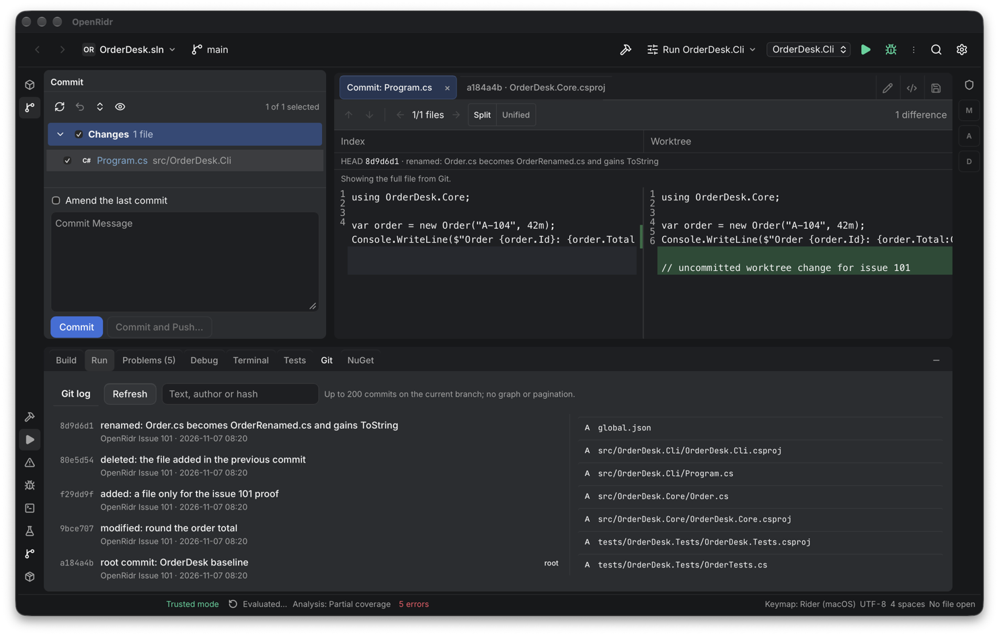

# Evidência — diff de um arquivo de um commit pelo Git log (#101)

Data: 2026-11-07. Alvo verificado: macOS arm64 (Apple Silicon). Windows e macOS Intel **não** foram executados.

## O que foi provado

### Host (`crates/host/src/git.rs`)

`cargo test -p openridr-host --lib -- commit_diff` → **5 passed**:

- **Modificado**: os dois textos completos, os hunks `-U0` e `commit`/`parent` com hash, hash curto e assunto; o teste deixa uma alteração **não commitada** no mesmo arquivo e o diff do commit não muda (o caso que separa esta leitura do `git.fileDiff`).
- **Adicionado** no commit: `base.exists == false` e o texto do commit no lado atual. **Deletado**: `current.exists == false` com o texto do commit na base.
- **Rename com edição** (`R080`): base = conteúdo do caminho antigo no pai, atual = caminho novo, hunk da linha alterada. Sem `originalPath` a base fica ausente — o teste prova que o caminho antigo é o que faz o diff ser um rename e não dois arquivos.
- **Commit raiz**: `parent: null`, base ausente, todas as linhas adicionadas (a empty tree vem de `git hash-object -t tree --stdin`).
- **Binário** (`\0`) → `full: false`, `fullReason: "binary"` e o patch como fallback; **hash inexistente** → `failed` com mensagem; **forma de hash inválida** (`--help`), **caminho** e **`originalPath`** fora do repositório → `invalid_state`.

`cargo test -p openridr-host --lib -- git::` → **59 passed**: os 54 testes que já existiam continuam passando depois de o tail do `file_diff` sair para a função compartilhada, incluindo os de arquivo inteiro, UTF-16, symlink e captura limitada.

`cargo test -p openridr-host --test host -- trust_grant_needs_an_open_workspace_and_gates_every_direct_call` → passa: o teste itera `EXECUTABLE_METHODS`, que agora inclui `git.commitDiff`, e exige `trust_required` em todos.

**Falha-antes medida**, revertendo só a correção e rodando o mesmo teste:

| Mutação | Resultado |
|---|---|
| `base_path = path` (ignora o caminho antigo do rename) | `commit_diff_uses_the_original_path_as_the_base_of_a_rename` reprova: base `None` em vez do conteúdo de `old.txt` |
| pathspec só com o caminho novo | o mesmo teste reprova: um hunk de arquivo inteiro (`old_start: 0, old_count: 0, new_start: 1, new_count: 20`) em vez do `@@ -10 +10 @@` |

O arquivo restaurado volta a passar (`5 passed`).

### Unidade (`bun test tests/unit/commitDiff.test.ts`)

**15 passed**, incluindo o caso novo do rename: base vinda do caminho antigo, atual do novo e um hunk de linha alterada montam as mesmas linhas de um arquivo modificado. Nenhuma função pura nova: `buildCommitRows` é reusado pela leitura do commit.

### App Tauri real (`agent-desktop`)

Bundle de debug `0.3.0-alpha.11` construído deste checkout (`src-tauri/target/debug/bundle/macos/OpenRidr.app`; o binário é deste checkout, mas os recursos embarcados — `csharp-ls`, `dotnet` e o binário do `netcoredbg` — foram copiados do app instalado `0.3.0-alpha.9`, porque a worktree não tem `src-tauri/resources`; nenhum caso desta prova usa o par de análise), `OPENRIDR_HOME` isolado (`/tmp/verify-openridr-issue-101-desktop/home`), workspace por argv sobre um repositório descartável em `/tmp` (cópia da fixture `OrderDesk`, sem `bin/`/`obj/`) com cinco commits — raiz, modificado, adicionado, deletado, rename com edição — mais um sexto de binário e uma alteração não commitada. Uma instância por vez, aberta com `desktop.sh up` e **fechada pelo PID gravado** (`desktop.sh down` → `stopped`; `pgrep -x openridr` vazio depois).

- **Linha do arquivo é botão:** cada arquivo do commit selecionado aparece como botão (`M src/OrderDesk.Core/Order.cs`, `R080 src/OrderDesk.Core/OrderRenamed.cs from src/OrderDesk.Core/Order.cs`); clicar abre a aba `<shortHash> · <arquivo>`.
- **Modificado:** split com o arquivo inteiro, rótulos `parent · a184a4b` / `9bce707`, linha `9bce707 · modified: round the order total`, nota "Showing the full file from Git.", `1 difference` e `1/1 files`; o conector azul aparece no gutter da linha 12.
- **Unificado:** um editor com `-        Total = total;` e `+        Total = decimal.Round(total, 2);`, marca intralinha, mesmo hash e mesma contagem.
- **Adicionado:** `No previous file` / `f29dd9f`, conteúdo inteiro verde à direita, metades verdes no conector.
- **Deletado:** `parent · f29dd9f` / `No current file`, conteúdo inteiro vermelho à esquerda.
- **Rename:** aba `8d9d6d1 · OrderRenamed.cs`, `parent · 80e5d54` / `8d9d6d1`; a esquerda mostra o conteúdo do **caminho antigo** (com `Total = decimal.Round(total, 2);`) e a direita o novo com o `ToString` adicionado.
- **Raiz:** `No previous file` / `a184a4b`, `6/9 files`; `Next changed file` andou para `src/OrderDesk.Core/OrderDesk.Core.csproj` na mesma aba e no mesmo commit.
- **Binário:** patch (`Binary files /dev/null and b/bin101.dat differ`) mais "full file not available: binary file.", `0 differences`.
- **As duas abas convivem:** `Commit: Program.cs` (working-tree diff, rótulos `Index`/`Worktree`, linha `HEAD 8d9d6d1 · …`) e `a184a4b · OrderDesk.Core.csproj` (diff do commit) abertas ao mesmo tempo; clicar numa e na outra troca o painel, e o working-tree diff continua com o comportamento de antes.

### E2E: trocado por host + unidade + app

A issue #101 pedia "provado por um E2E contra repositório descartável". A decisão do Helder na issue #67 — repetida no grill desta frente — é que Playwright é só smoke noturno, nunca verificação de UI de sessão, e que esta frente **não** ganha spec novo. A prova passou a ser host + unidade + app real, e a troca está registrada em `docs/SPEC-GIT-COMMIT-DIFF.md` e na decisão de 2026-11-07.

## Não verificado

- Windows e macOS Intel (não há build nem execução).
- **Navegação por seta entre as duas abas especiais**: exigiria `agent-desktop press --headed`, que move o foco do usuário; o caminho é o mesmo de antes com um índice a mais, provado só por leitura e por `tsc`.
- O fallback **`unreadable`** (blob/tree corrompidos) continua sem fixture de ponta a ponta: é ramo defensivo, provado só no host.
- **Merge commits**: o log não lista arquivos de merge, então não existe linha para clicar; o primeiro pai está documentado na spec para quando isso mudar.
- O `git.commitDiff` não foi exercitado pela ponte HTTP de dev (`host-http`); o caminho é o mesmo `dispatch` dos outros `git.*`, coberto pelo teste de trust.

## Rodada 1 da revisão independente

Revisor: `delegate_task` com `pi` / `openai-codex/gpt-6.1-terra` / `thinking=medium`, ponto fixo `1d8b044` (merge-base com `origin/main`). Quatro achados, todos corrigidos; o quinto era sobre esta evidência e foi corrigido aqui.

| Achado | Correção | Prova |
|---|---|---|
| **Médio:** o caminho era um pathspec, não um nome — `a[1].txt` é classe de caractere e o diff também trazia `a1.txt` | `--literal-pathspecs` em `commit_diff_output`, nas três pernas de `diff_output` e em `is_tracked` (o defeito também existia em `git.diff`/`git.fileDiff`) | `paths_are_literal_names_not_patterns`: sem a flag o commit devolve **2** hunks e o patch cita `a1.txt`; com ela, 1 hunk e nenhuma menção. Falha-antes medida revertendo só a flag do commit. O caso do `file_diff` e o de `is_tracked` passam com e sem a flag neste fixture (o Git tenta o nome literal antes do padrão), então ali a flag é intenção declarada, não a prova |
| **Médio:** metadados do commit lidos sem limite (`run` coleta o stdout inteiro) | `commit_ref` passou a usar `spawn_bounded` com 32 KB; truncado ou falho → sem linha do commit, nunca uma alocação sem teto | `commit_diff_returns_both_blobs_hunks_and_the_two_commits` e o teste do log continuam verdes |
| **Médio:** fechar a aba **inativa** zerava a aba especial visível | os dois botões de fechar só limpam `specialTab` quando a aba fechada é a ativa | caminho de UI; provado por leitura (`tsc` verde) — o app não foi reaberto para esta correção |
| **Baixo:** a aba usava o hash curto cortado em 7 caracteres pelo log, o painel usava o `%h` do Git | `git.log` passou a pedir `%h` no formato; o teste compara com `rev-parse --short` | `log_parses_messages_parents_and_changed_files` |
| **Baixo:** esta evidência atribuía o `too_large` ao teste do #48 | teste próprio de blob acima de 1 MiB no diff de commit | `commit_diff_falls_back_for_binary_and_rejects_unknown_commits` |

Depois das correções: `cargo test -p openridr-host --lib -- git::` → **60 passed**; `bun test tests/unit` → 90 passed; `bun run check`, `cargo fmt --all --check` e `cargo clippy --workspace --all-targets -- -D warnings` limpos.

## Rodada 2 da revisão independente (re-check)

Revisor: mesmo modelo e ponto fixo da rodada 1, com o diff das correções (`edbc696..HEAD`). Os quatro achados da rodada 1 foram confirmados fechados; sobrou **um médio**, corrigido:

| Achado | Correção | Prova |
|---|---|---|
| **Médio:** fechar a aba especial **ativa** zerava a seleção mesmo com a outra aba especial aberta — sem arquivo ativo, a área do editor caía no estado vazio com uma aba visível e não selecionada | fechar a aba ativa seleciona a outra aba especial quando ela existe, e só cai no editor quando não sobra nenhuma | caminho de UI, provado por leitura e por `tsc`; o app não foi reaberto para esta correção |

Dois reforços de teste saíram das observações do re-check (não eram achados): `log_keeps_a_tab_in_the_subject_and_git_folds_the_rest_into_it` (o `\t` do assunto sobrevive ao `splitn(3, '\t')` do parser) e a asserção de que um nome literal como `x[1].txt` não é reportado como não rastreado. Depois: `cargo test -p openridr-host --lib -- git::` → **61 passed**; `bun run check` limpo.
